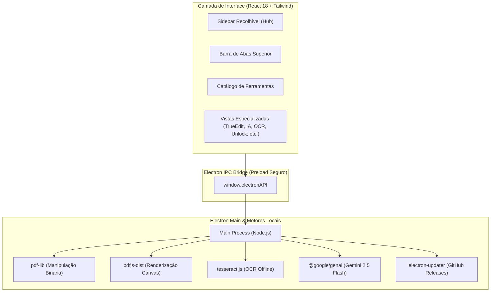

# <p align="center">📄 OmniPDF Studio</p>

<p align="center">
  <strong>A mais completa suíte de PDF para Windows com TrueEdit, Inteligência Artificial, OCR e Ferramentas 100% Offline.</strong>
</p>

<p align="center">
  <a href="https://github.com/Henrique1601/OmniPDF-Studio/releases/latest"></a>
  <a href="https://landing-topaz-ten-44.vercel.app"></a>
  <a href="https://github.com/Henrique1601/OmniPDF-Studio/blob/master/LICENSE"></a>
  <a href="https://www.electronjs.org/"></a>
  <a href="https://react.dev/"></a>
  <a href="https://www.typescriptlang.org/"></a>
</p>

<p align="center">
  <a href="https://github.com/Henrique1601/OmniPDF-Studio/releases/latest/download/OmniPDF.Studio.Setup.1.0.0.exe"><strong>🚀 Download do Instalador (.EXE)</strong></a> •
  <a href="https://landing-topaz-ten-44.vercel.app"><strong>🌐 Landing Page Oficial</strong></a> •
  <a href="https://github.com/Henrique1601/OmniPDF-Studio/releases"><strong>📦 Todas as Releases</strong></a> •
  <a href="#-principais-recursos"><strong>✨ Recursos</strong></a> •
  <a href="#-arquitetura-do-sistema"><strong>🏗️ Arquitetura</strong></a>
</p>

---

## 💡 O Que É o OmniPDF Studio?

O **OmniPDF Studio** é uma aplicação desktop nativa desenvolvida para substituir ferramentas web fragmentadas, lentas ou pagas (*Adobe Acrobat Pro, iLovePDF, Smallpdf*). Ele combina manipulação de PDF de alta fidelidade, **edição direta no documento (TrueEdit)**, reconhecimento óptico de caracteres (**OCR offline**), **inteligência artificial local e Gemini 2.5 Flash**, e privacidade absoluta: **seus arquivos nunca saem da sua máquina**.

Sua interface foi construída seguindo o modelo **Hub de Produtividade** (inspirado no iLovePDF Desktop): sidebar recolhível, navegação por abas estilo navegador, catálogo visual de ferramentas agrupadas por categorias e histórico local de tarefas.

---

## 📦 Download & Instalação para Windows

| Versão | Tipo | Link Direto | Tamanho |
| :--- | :--- | :--- | :--- |
| **v1.0.0 Oficial** | Instalador Windows (NSIS com atalhos) | [**Baixar `OmniPDF Studio Setup 1.0.0.exe`**](https://github.com/Henrique1601/OmniPDF-Studio/releases/latest/download/OmniPDF.Studio.Setup.1.0.0.exe) | ~119 MB |
| **v1.0.0 Portátil** | Executável sem necessidade de instalação | Disponível em `dist-package/win-unpacked/` | ~250 MB |

> **Nota de Instalação:** O instalador registra atalhos na Área de Trabalho e no Menu Iniciar, além de configurar suporte a atualizações automáticas via `electron-updater`.

---

## ✨ Catálogo de Ferramentas (Mais de 20 Ferramentas)

### 🤖 1. Inteligência Artificial & Smart Tools
- **Chat com PDF (IA):** Análise contextual profunda, resumos e perguntas com suporte a **Google Gemini 2.5 Flash** e **motor heurístico semântico 100% offline**.
- **Tradutor Integral de PDF:** Tradução completa para Português, Inglês, Espanhol, Francês ou Alemão, **preservando as coordenadas e o layout visual nativo**.
- **Auditor de Contratos & Riscos Jurídicos:** Extração automática de partes, vigência, valores, cláusulas penais e cálculo de score de risco jurídico (*Baixo / Médio / Alto*) com exportação em Markdown.
- **Busca Semântica em Pastas (RAG Local):** Indexação em memória de centenas de PDFs de uma pasta local para busca instantânea de termos, valores monetários ou cláusulas.

### ✍️ 2. Edição Direta & Anotações
- **TrueEdit (Inédito):** Edição e substituição in-place de blocos de texto no PDF preservando a tipografia e aplicando máscaras sólidas automáticas.
- **Assinatura Manuscrita:** Painel de desenho com física de traço suave ou carimbo digital posicionável com ajuste visual de escala e rotação.
- **Marca-Texto Inteligente:** Destaques semi-transparentes coloridos (amarelo, verde, azul, rosa) aplicados sobre os textos selecionados.
- **Numeração de Páginas:** Cabeçalho e rodapé automáticos (*"Página X de Y"*, simples ou prefixado) com controle de margens e opção de pular capa.
- **Marca d'Água:** Carimbos textuais com personalização de tamanho, ângulo, rotação e opacidade.
- **Anotações & Notas:** Inserção livre de notas e caixas de anotação no PDF.

### ⚡ 3. Otimização, Segurança & Privacidade
- **Desbloquear PDF (Unlock):** Reconstrução de árvore de objetos para **eliminar restrições de impressão, cópia de texto e senhas de permissão**.
- **Censurar & Redigir (LGPD):** Remoção permanente de CPF, e-mails, telefones e dados sensíveis via tarjas pretas sobrepostas nos bytes binários.
- **OCR Offline:** Reconhecimento óptico de caracteres em PDFs digitalizados via Tesseract.js (Português, Inglês, Espanhol) sem internet.
- **Compactar PDF:** Otimização estrutural com ativação de Object Streams e limpeza de objetos órfãos.
- **Proteger com Senha:** Criptografia e trava de abertura por senha corporativa.
- **Comparar PDFs:** Comparador visual e textual lado a lado para controle de versões e auditoria de alterações.

### 📁 4. Organização & Conversão
- **Juntar PDFs (Merge):** Unificação de múltiplos arquivos em qualquer sequência.
- **Dividir PDF (Split):** Extração de intervalos específicos de páginas.
- **Organizar Páginas:** Grade interativa para girar 90°, reordenar ou excluir páginas individuais.
- **Processamento em Lote (Batch):** Aplicação de compressão, proteção, marcas d'água ou numeração em dezenas de documentos simultaneamente.
- **PDF para Imagem:** Exportação de páginas em PNG ou JPEG de alta definição.
- **Imagens para PDF:** Conversão de lotes de fotos, digitalizações e prints em um único documento PDF.

---

## 🎨 Interface & Navegação (Modelo Hub iLovePDF)

- **Sidebar Recolhível:** Alternância com 1 clique entre modo expandido e coluna de ícones compactos.
- **Seções Dedicadas:**
  - `Home`: Dashboard de boas-vindas com atalhos rápidos e abertura de arquivos.
  - `Recents`: Histórico de documentos abertos recentemente com acesso imediato.
  - `Tools`: Catálogo visual completo com busca rápida e categorias expansíveis.
  - `Tasks History`: Registro das tarefas e conversões concluídas com sucesso.
  - `Preferences`: Gerenciador de Chave Gemini API, idioma do OCR, nível de compressão e verificador de updates.
- **Abas Superiores (Top Tabs):** Navegação ágil entre a Home, as ferramentas em execução e os documentos carregados.

---

## 🏗️ Arquitetura do Sistema



---

## 🛡️ Privacidade & Segurança (100% Offline First)

1. **Zero Telemetria Externa:** O processamento de divisão, união, compressão, TrueEdit e OCR ocorre estritamente na memória RAM da sua máquina.
2. **Segurança de Chaves de API:** Sua chave do Google Gemini permanece gravada exclusivamente no armazenamento local criptografado do seu dispositivo.
3. **Censura LGPD Real:** A ferramenta de censura não apenas pinta de preto visualmente, mas reconstrói a árvore de texto para impedir que os dados confidenciais sejam selecionados ou recuperados via clipboard.

---

## 💻 Como Executar em Modo de Desenvolvimento

```bash
# 1. Clone o repositório
git clone https://github.com/Henrique1601/OmniPDF-Studio.git
cd OmniPDF-Studio

# 2. Instale as dependências
npm install

# 3. Inicie o servidor de desenvolvimento Vite + Electron
npm run dev

# 4. Compile e empacote o instalador para Windows
npm run dist
```

---

## 📄 Licença & Autor

- **Autor:** [Henrique Bezerra Dos Santos](https://github.com/Henrique1601)
- **Licença:** Este projeto está sob a [Licença MIT](LICENSE). Sinta-se livre para usar, estudar e contribuir.
